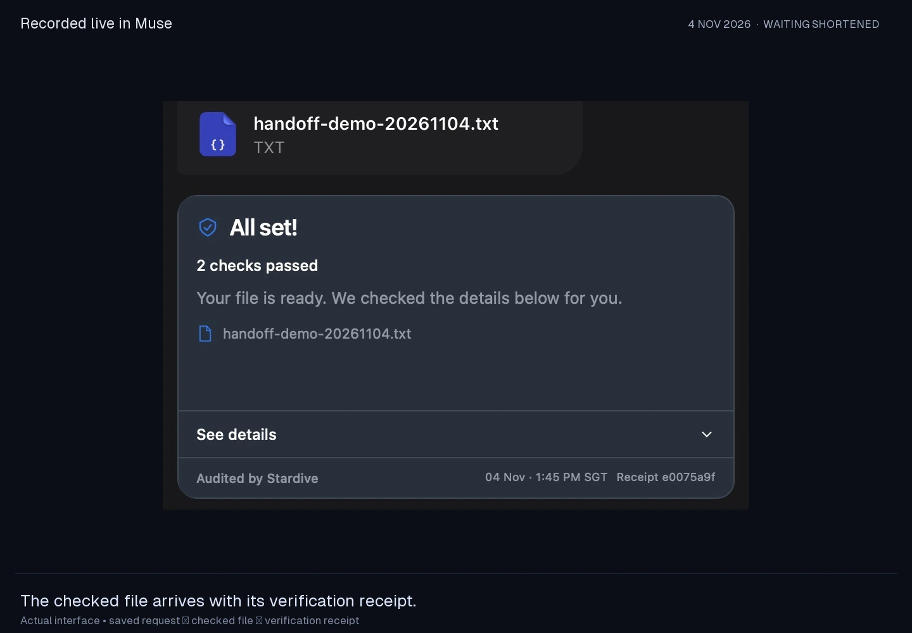
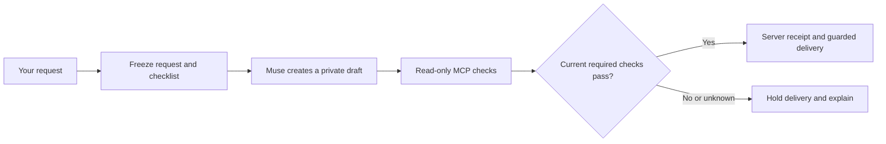

# Stardive for Muse

**AI work checked against what you asked for.**

[Product demo](https://www.stardive.xyz/hackathon/) · [Watch the submission video](https://github.com/JyTey2004/muse-audit/releases/tag/meta-hackathon-2026) · [Workflow](connectors/muse_controlled/README.md) · [Hackathon notes](docs/HACKATHON.md)

[](https://www.stardive.xyz/hackathon/)

You ask Muse for a file. Stardive checks supported requirements against the
actual result and releases the matching file when required checks pass. The
small card in Muse shows what you requested, what was checked and which result
the receipt covers.



## See the working product

The [4 November Muse run](docs/demo/live-product-record.json) asks for an exact
welcome note under twenty words. Its receipt has two passing checks. Independent
backend reads of the task, receipt, completion and result confirmed the same
48-byte file and SHA-256. The [evidence graph](docs/demo/live-product-event-graph.json)
connects those retained records.

The video uses actual interface frames with waiting shortened. The website is a
recorded demonstration and explanation. Running the native workflow requires a
configured Muse account and authenticated backend; the demo account is not shared.

## Try it locally

Python 3.12 and Node.js 22 are the CI reference environment. The synthetic demo
needs no model account, key or paid call:

```sh
git clone https://github.com/JyTey2004/muse-audit.git
cd muse-audit
python3 -m venv .venv
.venv/bin/python -m pip install -r requirements.txt -c constraints-python312.txt
.venv/bin/python -m muse_audit.demo --output /tmp/stardive-first-demo
```

Open `/tmp/stardive-first-demo/index.html`. The budget and document examples show
failed requirements, reviewed repairs into new copies, rechecks and unresolved
conditions. Use a fresh output directory each time; earlier evidence is preserved.

To view the recorded product page locally:

```sh
python3 -m http.server 8000 --directory web
```

Open `http://localhost:8000`. This static page plays recorded evidence. It does not
send tasks to a live agent.

## Code map

| Part | Role |
| --- | --- |
| `connectors/muse_controlled/` | Two native Muse phases, guarded publisher and compact receipt card |
| `muse_audit/native_connector/` | Authenticated intake, immutable versions, recomputed receipts and completion |
| `muse_audit/taskflow/` | Frozen requirements, executable checks, read-only MCP review and recheck |
| `muse_audit/adapters/` | Bounded local XLSX/DOCX checks; native Office acceptance remains separate |
| `extensions/meta_consumer/` | Optional Voice Transcribe, Spark and Wonder adapters and preview; live API validation pending |
| `docs/demo/` | Selected public synthetic records, checked note and video thumbnail |
| `web/` | Public product recording and workflow diagrams |

Three read-only MCP tools perform capabilities/review/recheck. Separate
authenticated HTTP operations persist immutable inputs and receipts. The server
recomputes checks, validates freshness at completion/download and requires a
passing receipt. The publisher compares returned bytes before attachment.

Start with the [native workflow](connectors/muse_controlled/README.md),
[taskflow setup](README-TASKFLOW.md) or [backend quickstart](BACKEND-QUICKSTART.md).

## Run the checks

```sh
.venv/bin/python -m unittest discover -s tests -v
.venv/bin/python -m unittest discover -s tests_backend -v
.venv/bin/python -m unittest discover -s tests_adapter -v
.venv/bin/python -m unittest discover -s tests_taskflow -v
.venv/bin/python -m unittest discover -s tests_connector -v
.venv/bin/python -m unittest discover -s tests_controlled -v
node tests_controlled/test_workflow.mjs
.venv/bin/python tests/test_protocol.py
.venv/bin/python tests_adapter/test_protocol_adapter.py
```

The optional extension's offline suite is separate:

```sh
cd extensions/meta_consumer
python3 -m unittest discover -s tests -v
```

## Evidence and limits

- Receipts cover listed requirements and selected evidence. Checklist completeness,
  source authenticity and general semantic truth remain unverified.
- Separate Muse work/check workers are present. A distinct-model semantic judge
  and a complete trace of hidden agent actions have not been established.
- Retained failed-check and skipped-verification controls block canonical release.
  Seeded faults are distinct from naturally occurring mistakes.
- The six-pair exploratory comparison produced correct files in both arms. A larger
  comparison is unfinished. No accuracy advantage or user checking-time saving is claimed.
- The configured workflow is scoped. Trusted code, private run context and the
  evidence store remain part of its trust boundary.
- No insurance coverage or payout guarantee is offered.

## Hackathon provenance

The submitted increment was built during 26 October–5 November 2026: bounded
audit examples, dynamic taskflow, native Muse orchestration, receipt/completion
enforcement, guarded delivery, compact card and recorded product site. Earlier
Stardive task-assurance research informed the idea; private research infrastructure
is excluded and is not required by the local examples. See [submission notes](docs/HACKATHON.md).

This public slice contains synthetic examples and selected demonstration records.
It excludes private CKG research, credentials, account exports, raw private logs
and the unfinished benchmark. A reuse license has not been selected. Third-party
assets retain their notices. Earlier status is preserved in the
[dated checkpoint](docs/history/20261029-checkpoint.md).
